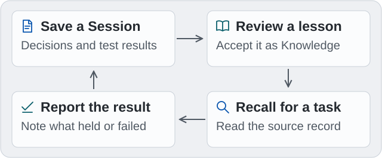
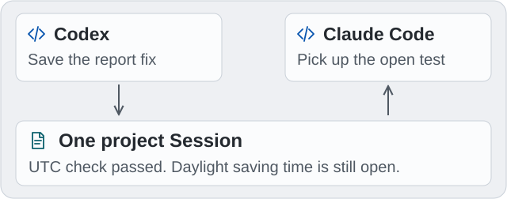
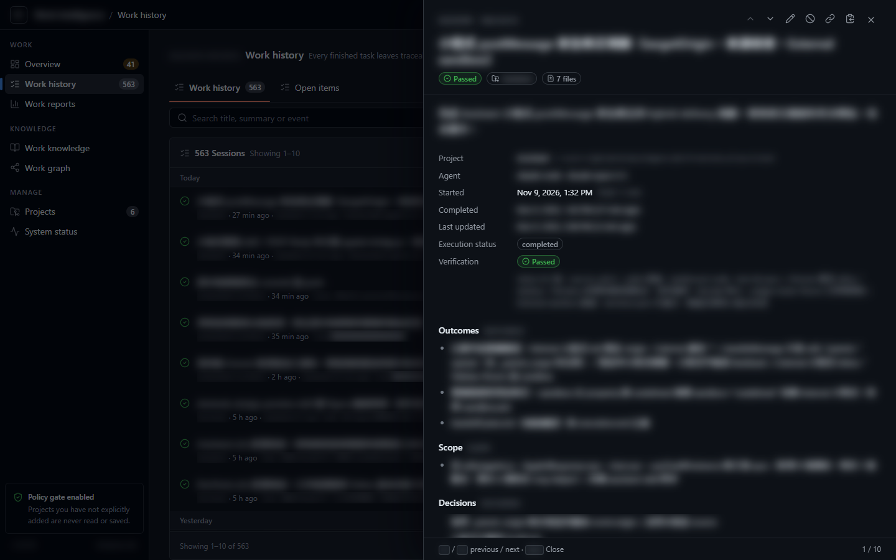
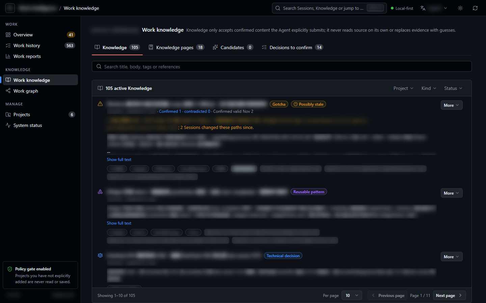
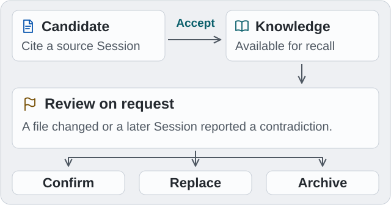
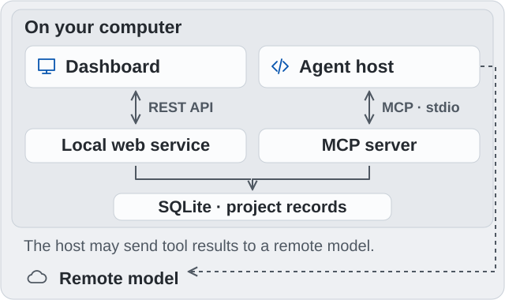

# WorkLog.Ai

**English** | [繁體中文](README.zh-TW.md)

**Give AI coding agents verified experience, not just memory.**

Developer Work Intelligence for Codex and Claude Code. WorkLog.Ai keeps a local record of what changed in a project, why you chose an approach, and which checks passed or failed. When you return to a file or switch Agents, you can ask for the earlier decision and the evidence behind it.

## Download and install

Download the Work Intelligence desktop App for **Windows 11 (x64)** or **macOS (Apple Silicon or Intel)**. Choose the Windows x64 setup file, the Mac arm64 disk image for Apple Silicon, or the Mac x64 disk image for Intel. [Download from GitHub Releases](https://github.com/Ponpon55837/WorkLog.Ai/releases/latest)

The installers have no publisher signature. Windows SmartScreen or macOS Gatekeeper may show a warning. The release includes `SHA256SUMS.txt` for checking your download. [Installation and checksum instructions (Traditional Chinese)](docs/user-guide.md#桌面-app-檢查更新)

## How it works

Before editing a file, ask your Agent to look up earlier changes to it. A Session records the outcome, scope, decisions, verification results and open items from one piece of work. When the next task touches the same file, the Agent can read the source Session to see what was tested and what still needs checking.

<picture>
  <source media="(prefers-color-scheme: dark)" srcset="docs/images/en-US/experience-loop-dark.svg">
  
</picture>

## Save your first Session in three steps

1. **Choose a project.** Open the App and choose **Start with the defaults**, or **Keep using this data** if it finds an existing database. Open the dashboard from the system tray. Under **Projects → Add project**, choose your folder and set it to **Tracked**. Only you can enable recording for a project.
2. **Connect an Agent.** On the desktop App’s **Agent** tab, choose Codex or Claude Code. Select **Preview changes**, review the files, then select **Apply changes** and **Test the connection**. Open a new Agent conversation in the tracked project.
3. **Save and check the result.** After completing a task, ask “Please save this work in WorkLog.Ai, including what we tested and what’s still open.” In the dashboard, open **Work history** and select the new Session to check the record.

## Using project records

| When you need to… | Ask your Agent |
| --- | --- |
| Understand a file before changing it | “Why did we convert timestamps in the report formatter? Show me the Session where we decided.” |
| Investigate a recurring failure | “Have we seen this time-zone test failure before? Which fix did we try, and what was the result?” |
| Prepare a weekly report | “Summarize this week’s completed work and link the source Sessions.” |
| Continue in another Agent | “Find the Session that Codex saved for the report fix. Which case still needs a test?” |

For example, Codex can save that a report fix passed the UTC test and that the daylight-saving case is still open. Open Claude Code in the same tracked project and it can retrieve that Session through MCP, check the outstanding case and record the result.

<picture>
  <source media="(prefers-color-scheme: dark)" srcset="docs/images/en-US/agent-handoff-dark.svg">
  
</picture>

## Product preview

**Work overview** brings recent project activity and items needing attention into one view.

**Session details** shows the outcome of a change alongside its verification and supporting evidence.

**Work knowledge** is where you review candidates and revisit accepted project Knowledge.

## Reviewing project Knowledge

A Session describes a particular change. If its lesson applies more broadly, an Agent can propose a Knowledge candidate and cite the source Session. Review the evidence, edit the wording if needed, then accept or reject the candidate. You can also explicitly ask an Agent to review pending items.

Later work can confirm or contradict accepted Knowledge. If a related file changes, check whether the guidance still applies. You can revise or archive an entry and inspect its history. [Knowledge review guide (Traditional Chinese)](docs/user-guide.md#工作知識)

<picture>
  <source media="(prefers-color-scheme: dark)" srcset="docs/images/en-US/knowledge-lifecycle-dark.svg">
  
</picture>

## Local architecture and privacy

Only projects you explicitly set to **Tracked** are read and recorded. The dashboard connects to a service listening on `127.0.0.1`. Codex and Claude Code use a local MCP server to access the same SQLite database.

<picture>
  <source media="(prefers-color-scheme: dark)" srcset="docs/images/en-US/local-privacy-dark.svg">
  
</picture>

Your Agent host may send tool results to a remote model under its own policy. Backups and exports are **unencrypted**, so choose where you store and share them. [Security and vulnerability reporting](SECURITY.md) · [Backup and restore (Traditional Chinese)](docs/user-guide.md#換電腦與還原)

## Documentation and development

**For developers working from a checkout.** Run `pnpm bootstrap`, then `pnpm start` to open the local dashboard. See the development guide for prerequisites and test commands.

The guides below are in Traditional Chinese.

| Topic | Documentation |
| --- | --- |
| Using the App | [User guide](docs/user-guide.md) · [Agent setup](docs/agent-setup.md) · [Troubleshooting](docs/troubleshooting.md) |
| Dashboard views | [Usage](docs/user-guide.md#用量) · [Reports](docs/user-guide.md#報告與-knowledge) · [Work graph](docs/user-guide.md#工作圖譜) |
| Development and command-line use | [Development setup and tests](CONTRIBUTING.md) · [Standalone package](docs/standalone.md) · [Start at login](docs/service.md) |
| Integrations | [Architecture](docs/architecture.md) · [MCP tools](docs/mcp-tools.md) · [REST API](docs/rest-api.md) |
| Releases | [Changelog](CHANGELOG.md) · [Release notes](docs/releases/) · [Release process](docs/release.md) · [Project status](docs/status.md) |

## License

[MIT](LICENSE)
