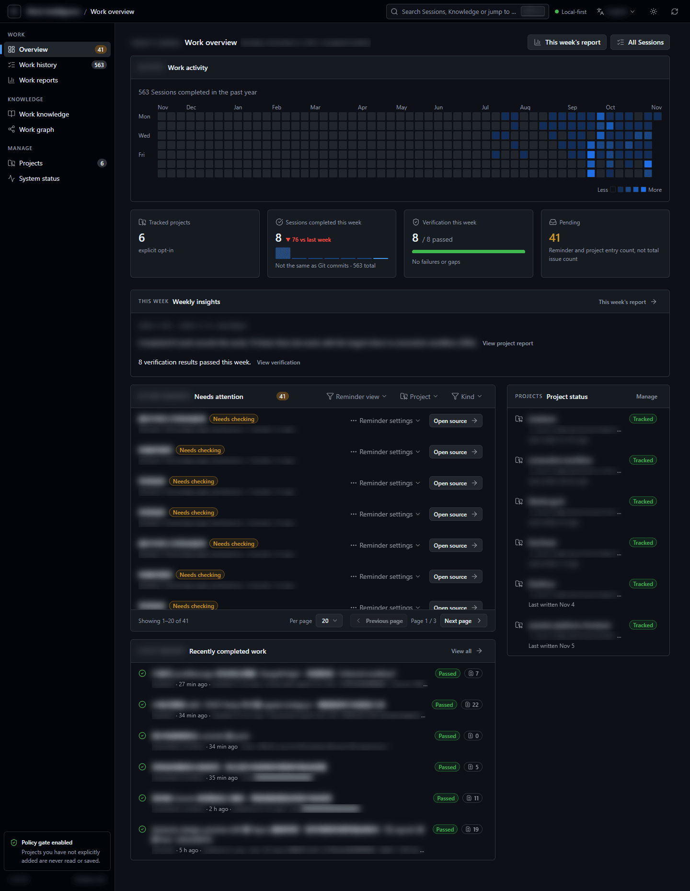
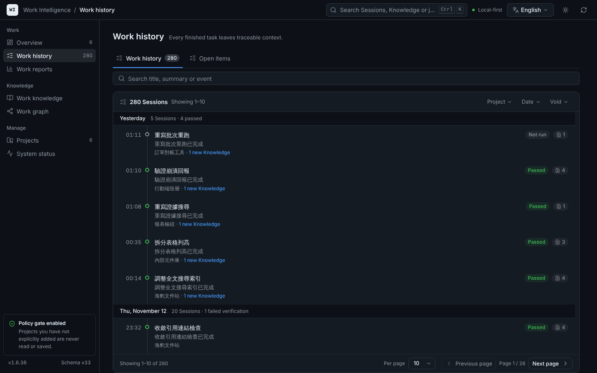

# WorkLog.Ai

**English** | [繁體中文](README.zh-TW.md)

**Give AI coding agents verified experience, not just memory.**

Agents forget why a change was made, which approaches already failed, and whether a fix was actually verified. WorkLog.Ai keeps structured work records, file context, evidence and reviewed project knowledge on your computer, so the Agent can pull up relevant experience before it starts the next task.

Built for: Codex / Claude Code · Local-first · Evidence-backed records · MCP

**Developer Work Intelligence**

---

## Contents

- [Preview](#preview)
- [Get started in three steps](#get-started-in-three-steps)
- [Main use cases](#main-use-cases)
- [Security and privacy](#security-and-privacy)
- [Advanced use and development](#advanced-use-and-development)
- [License](#license)

## Preview





## Get started in three steps

### 1. Download the App

WorkLog.Ai is a desktop App for **Windows 11 (x64)** and **macOS (Apple Silicon and Intel)**. Installers include everything the App needs, including Node.js, so you do not install Node.js yourself.

1. Open the [GitHub Releases](https://github.com/Ponpon55837/WorkLog.Ai/releases) page and download the installer for your system from the newest release:
   - Windows: `Work-Intelligence-<version>-win-x64-setup.exe`
   - macOS: `Work-Intelligence-<version>-mac-arm64.dmg` (Apple Silicon) or `Work-Intelligence-<version>-mac-x64.dmg` (Intel)
2. Run the installer and open the App.

The installers are **not code-signed**, so your system may show a warning the first time you open them. This does not mean the file is damaged.

- **macOS**: if Gatekeeper blocks the App, open **System Settings → Privacy & Security**, find the message about the App near the bottom, and choose to open it anyway.
- **Windows**: if SmartScreen shows "Windows protected your PC", choose **More info**, then **Run anyway**.

To check that a download is complete, compare its SHA-256 with the `SHA256SUMS.txt` file on the same release page. The steps are in the [user guide](docs/user-guide.md#桌面-app-檢查更新) (Traditional Chinese).

The App checks for updates only when you press **Check for updates** in its Settings tab. It never checks in the background, and it does not install updates for you.

### 2. First-time setup

1. Open the App. On first run, choose **Start with the defaults**. If the App finds an existing database, you can choose **Keep using this data** instead.
2. Open the Web dashboard from the tray menu (**Open Dashboard**), go to **Projects**, choose **Add project**, and pick the folder you want to record.
3. Set the project to **Tracked**. Projects start as *Unregistered*, and the Agent cannot change this for you.
4. Set up your Agents (next step), then open a new conversation in Codex or Claude Code and ask the Agent to save your work when you finish.

The Web dashboard shows a short checklist of these steps until you have a tracked project and a saved Session.

### 3. Set up your Agents with the App

In the App, open the **Agent** tab (or press **Set up Agents…** on the first-run page). The tab shows one card for Codex and one for Claude Code.

- **Preview first.** **Preview changes** shows every file the App would change. Nothing is written until you confirm.
- **Apply and undo.** **Apply changes** writes the previewed plan and records it. **Undo the last change** restores the files as they were before.
- **Test connection.** The card can check that the WorkLog.Ai MCP server starts and responds.
- **Already set up by hand?** If you added the server yourself, the card shows the status **Managed elsewhere** and offers **Let the desktop App manage it…**. The App takes over the registration after you preview it, and undo returns the files to exactly how they were.
- **Remove.** **Remove Agent setup** uses the same preview and confirmation steps as setup.

Each card shows the Agent's connection status:

- **Connected**: the Agent has used WorkLog.Ai tools.
- **Set up, not confirmed yet**: the setup is written, but the Agent has not used the tools yet. Ask it a question about a tracked project to confirm.
- **Needs to reconnect**: the Agent loaded an older version of the server. Close the Agent conversation and open it again.
- **Conflicting settings**: the App cannot change a setting safely. The card explains why and what to do.

The System status page of the Web UI shows **MCP connections**. If it shows 0 or fewer than you expect, the page explains why. One common case after an upgrade: **Agent conversations that were already open before the upgrade keep the old MCP server and are not counted.** Close and reopen those conversations, and the count updates.

## Main use cases

You talk to the Agent in plain language. The Agent handles the tool calls.

| To… | Say to the Agent |
|---|---|
| Check whether a project is recorded | "Is this project being recorded in WorkLog.Ai?" |
| Save the work you just finished | "Done. Please record this work in WorkLog.Ai." Untracked projects are skipped. |
| Look up past work or an error | "Have we dealt with the report time-zone problem before?" or paste the error message. |
| Recover project context | "First check what has happened in this project recently in WorkLog.Ai." |
| Write a report | "Summarize this week's WorkLog.Ai report for me." |
| Tidy open items | "Please tidy this project's open items." |

You can also do most of this in the Web dashboard (tray menu → **Open Dashboard**):

- **Work history** (Web dashboard): search Sessions, edit a summary, link or void a Session, and review open items.
- **Work reports** (Web dashboard): daily, weekly, monthly, quarterly, yearly or custom-range reports, exported as Markdown or JSON.
- **Work knowledge** (Web dashboard): accepted Knowledge, Knowledge pages and candidates. Candidates become Knowledge only after you accept them.
- **Projects** (Web dashboard): add, track, pause or delete projects.
- **Usage** (Web dashboard, next to System status): turns, tool calls, tokens and the Work Intelligence operations your Agents called, read from the local Claude Code and Codex logs of the tracked projects you pick (the current project by default, or "All projects"). Worktree folders count with their project. Pick the last 7 days, the last 30 days or a custom range. The headline is **Input + output (excl. cache)**: uncached input plus output. Cache read and cache write are listed on their own and never added to it. The page also shows tokens per day, tokens by Agent and model (names that look like paths or placeholders show as **Unlabelled model**) and, while you are using an Agent, the current 5-hour block. It converts nothing to money, has no price table and makes no network calls. **Copy for Agent** shows the text first, then copies totals, project names, model names, operation names and conversation numbers such as `session-1`; it never includes paths, folder names or message text. If a project moved and nothing is detected, add its log folders under **Advanced: add folders manually**. The page only reads the logs and never writes to `~/.claude` or `~/.codex`.

Every Session has a one-sentence summary and five fixed sections: **Outcomes, Scope, Decisions, Verification, and Status and open items**. Verification has five states: passed, failed, in progress, not run, and not reported. Starting work never counts as passed. Every summary links back to its Sessions, files and evidence.

## Security and privacy

- **Nothing is recorded by default.** Only projects you set to "Tracked" are read and saved.
- **Your data stays on your machine.** The App's local service listens only on `127.0.0.1`, and nothing is sent anywhere by WorkLog.Ai itself.
- The local service checks the `Host` and `Origin` headers.
- Text is checked for known credential formats before it is stored, and anything wrapped in `<private>…</private>` is replaced with `[REDACTED:private_block]`.
- Backups and exports are not encrypted. Keep them private.
- When an Agent uses WorkLog.Ai, the Agent host may send tool results to a remote model, according to that host's own policy.
- Successful MCP reads are logged locally with IDs and counts only, never queries or content.

The threat model and how to report vulnerabilities are in [SECURITY.md](SECURITY.md).

## Advanced use and development

### Data, backups and moving to a new computer

Everything lives in one SQLite database. The App's **Data** tab handles restore and database maintenance; the Web dashboard's **Projects** page handles backup lists, manual backups, export and import.

- **Back up now** (Web dashboard, **Projects → Data backup**) creates a manual backup. Automatic backups run once a day, and the App keeps the latest few of each kind.
- **Restore from backup** (App **Data** tab) replaces the database with a backup you choose. Before it starts, the App asks you to close your Agent conversations, and it backs up your current data first. A backup that fails its checks is refused, and your current data stays as it is.
- **Moving to a new computer.** Restore on the new computer. If a project folder from the backup is missing there, the App asks where it is now. Pick a folder, and the App matches projects with the same name under it. You can pick several folders, keep the old paths for the rest, or cancel.
- **Maintain the database…** (App **Data** tab) backs up first, then checks integrity, compacts the file, rebuilds the search index and shows how much free space was reclaimed. **Check integrity** only reads, and changes nothing. Maintenance does not start while an Agent is connected or an import, backup or restore is running.
- **Export and import** (Web dashboard, **Projects**) move projects as JSON, with a preview before anything is written. Export files are not encrypted, so keep them somewhere safe.
- **Deleting a project** makes a full backup first. The deletion record keeps only the time, project ID and counts. Older backups still contain the project until they rotate out or you delete them.

Backups and exports are not encrypted. Store and move them by trusted means.

### Settings you can change

The **Settings** tab holds:

- **Language.** The **Language** card at the top of the tab has a **Display language** choice: **Follow system (English)** (the default; the name in brackets is the language the system currently reads as, where a system language starting with zh gives Traditional Chinese and anything else gives English), **繁體中文** or **English**. The App window, the tray menu, the macOS application menu and the App's dialogs switch at once, with no restart. The Dashboard the App manages uses the same language: changing it in the Dashboard changes the App's setting too. The one exception is when the App is on Follow system and you pick in the Dashboard the language the system already reads as, in which case the App stays on Follow system. A standalone server (not run by the desktop App) still keeps the Dashboard's language in the browser.
- **Start at login.** A switch to turn it on or off at any time (Windows and macOS). It shows the system's actual state. If the setting was changed in the system's startup settings, or macOS is waiting for your approval, the card says so.
- **Backup location.** Choose a different folder. The App checks that the folder is writable. Network drives are refused, and external drives or cloud-synced folders ask for confirmation first. Existing backups are not moved.
- **Updates.** Check for a new version on demand.

If your chosen port is taken, the App starts on the last port that worked and explains this on the Status tab. Your setting is not changed.

The **Diagnostics** tab shows a preview and then **Export diagnostics…** saves a JSON file you can attach to a bug report. It masks file paths, authorization codes, tokens and email addresses, and does not include work-record content. The App never uploads it.

### For developers and command-line users

> **Audience: developers and people who work from a terminal.** Everything in this section is optional. The desktop App does all of it for ordinary use.

A checkout requires Node.js 22.16 or later on the 22 line, or 24 and later (23.x is not supported), and pnpm 11.16 or later.

```bash
git clone https://github.com/Ponpon55837/WorkLog.Ai && cd WorkLog.Ai
pnpm bootstrap
pnpm start
```

`pnpm bootstrap` installs, builds, previews the Agent setup and start-at-login setup, and asks for confirmation before it writes to your global settings. `pnpm start` serves the Web UI and API at <http://127.0.0.1:3210>. `pnpm check` runs read-only diagnostics.

Command-line tools and the standalone package are covered in these guides:

- [Command-line and development guide](docs/user-guide.md#給開發者與命令列使用者安裝與正式模式) (Traditional Chinese)
- [Agent setup and save-reminder hooks](docs/agent-setup.md) (Traditional Chinese)
- [Standalone package](docs/standalone.md) (no checkout needed)
- [Start at login from the command line](docs/service.md)

Useful environment variables:

| Variable | Purpose |
|---|---|
| `WORK_INTELLIGENCE_DB` | Database location. Relative paths resolve from the repository root. |
| `WORK_INTELLIGENCE_PORT` | Local port, `3210` by default. |
| `WORK_INTELLIGENCE_BACKUP_DIR` | Backup folder. Command-line mode defaults to `backups/` next to the database; the desktop App defaults to `~/.work-intelligence/backups/` (changeable in the App's **Settings** tab). |
| `WORK_INTELLIGENCE_BACKUP=off` | Turns off the daily automatic backup. |

Development commands:

```bash
pnpm dev                 # Web UI on 5966 (Vite) and API on 3210
pnpm build               # production build
pnpm test                # lint, format check and unit tests
pnpm typecheck           # types for packages, Vue and E2E
pnpm test:e2e            # Playwright end-to-end tests after a build
```

Repository layout:

```text
apps/
  desktop/     the desktop App (Electron shell, installers)
  web/         Vue 3 + Vite Web UI
  server/      REST API, production static files, CLI (db:*), doctor
  mcp/         MCP stdio server, the launcher Agents connect through, and save-reminder hooks
packages/
  core/, schema/, storage/, project-policy/, shared/, desktop-core/, agent-setup/, ui-tokens/
tests/         unit, integration and E2E tests
docs/          user guides, release notes and design records
```

### Documentation

| Document | Contents |
|---|---|
| [docs/user-guide.md](docs/user-guide.md) | Everyday use, reports, Knowledge, backups, moving computers, updates (Traditional Chinese) |
| [docs/troubleshooting.md](docs/troubleshooting.md) | Common problems in the App and on the command line (Traditional Chinese) |
| [docs/agent-setup.md](docs/agent-setup.md) | Agent setup, the App's Agent tab, and save-reminder hooks (Traditional Chinese) |
| [docs/service.md](docs/service.md) | Start at login (Traditional Chinese) |
| [docs/standalone.md](docs/standalone.md) | Standalone package for command-line users (Traditional Chinese) |
| [docs/release.md](docs/release.md) | Releases and upgrades, for maintainers (Traditional Chinese) |
| [docs/mcp-tools.md](docs/mcp-tools.md) | MCP tools, fields and policy behaviour |
| [docs/rest-api.md](docs/rest-api.md) | REST endpoints and error codes |
| [docs/architecture.md](docs/architecture.md) | Data contracts, consistency and the recording policy |
| [docs/status.md](docs/status.md) | Current status and open items |
| [CHANGELOG.md](CHANGELOG.md), [docs/releases/](docs/releases/) | Version history and per-version notes |
| [CONTRIBUTING.md](CONTRIBUTING.md) | Development workflow and pull request rules |
| [SECURITY.md](SECURITY.md) | Threat model and private vulnerability reporting |

## License

[MIT](LICENSE)
