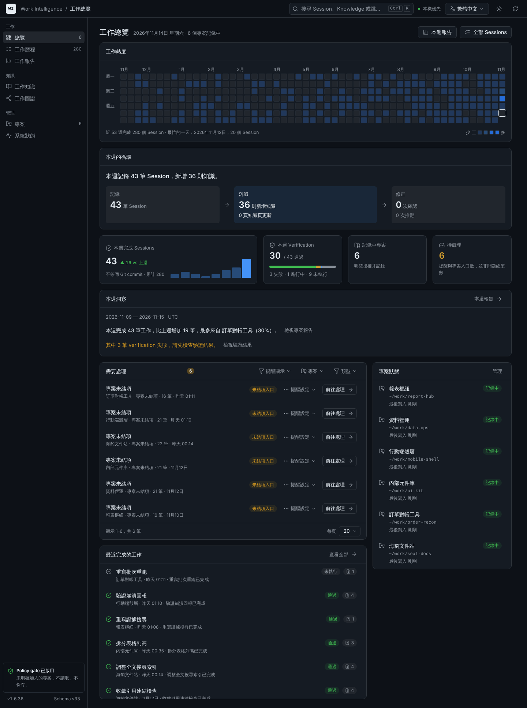
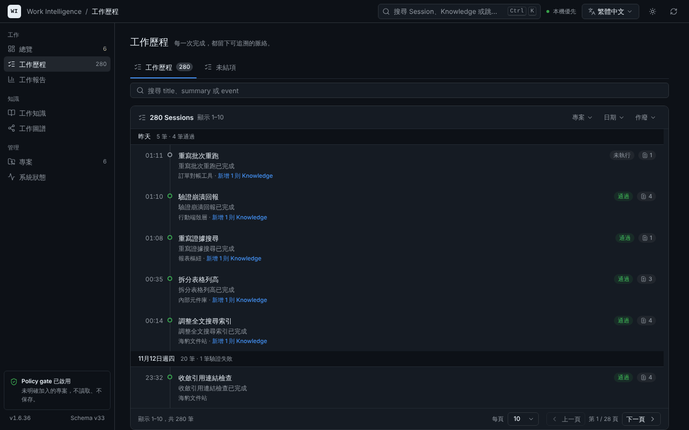
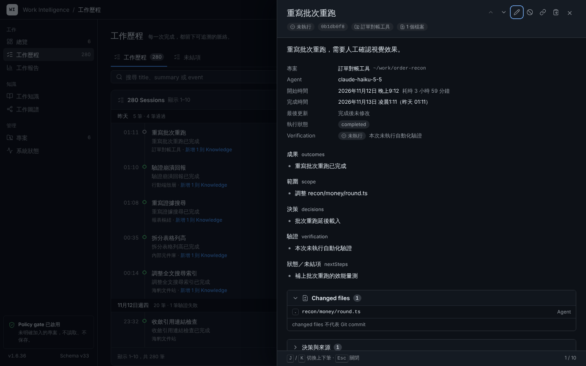
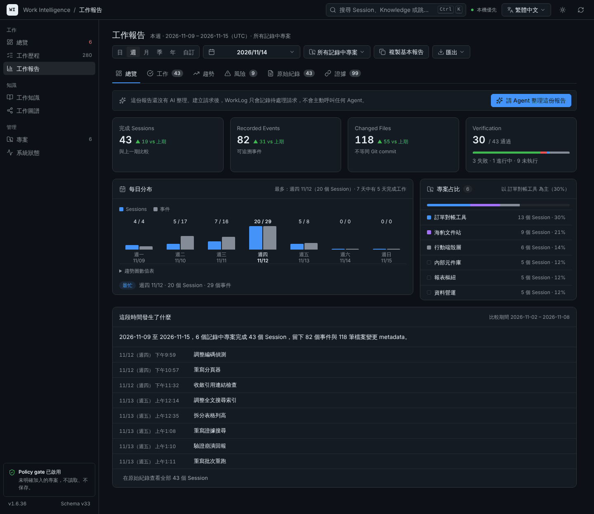
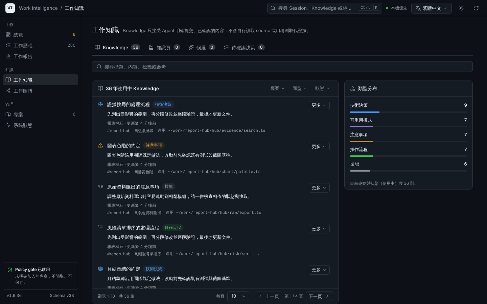
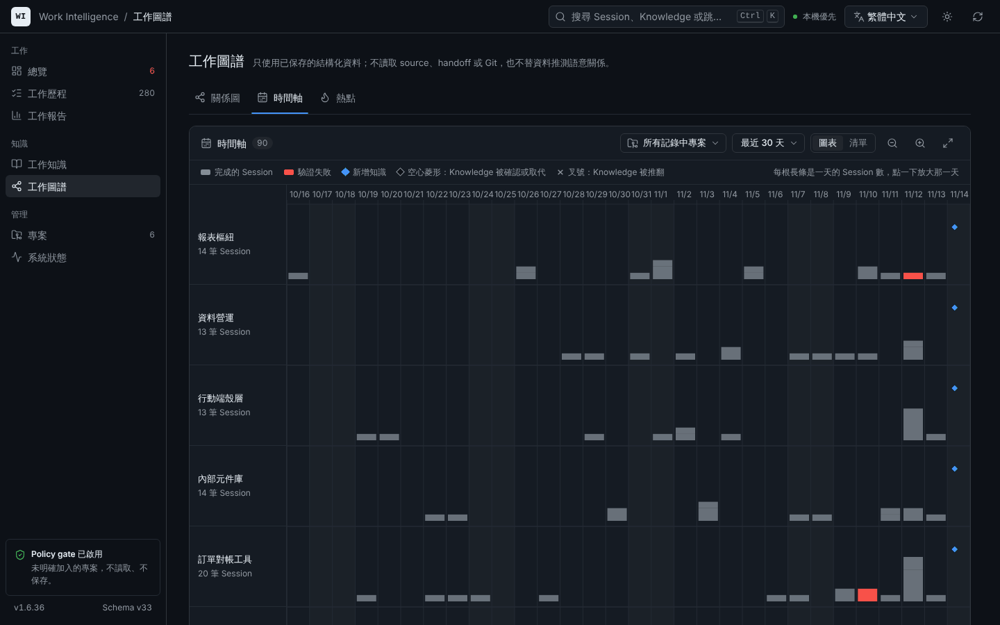
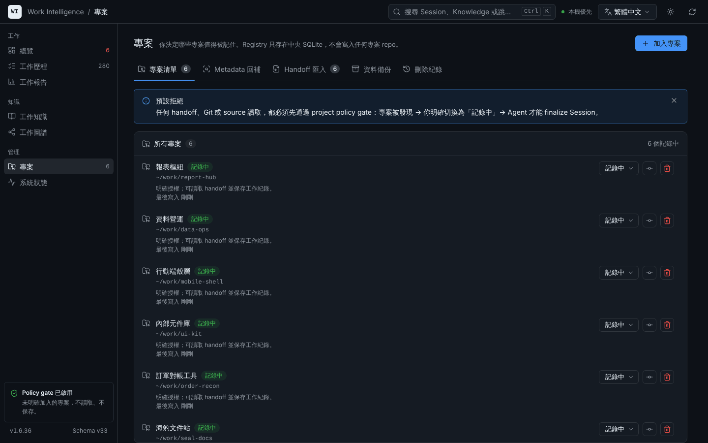
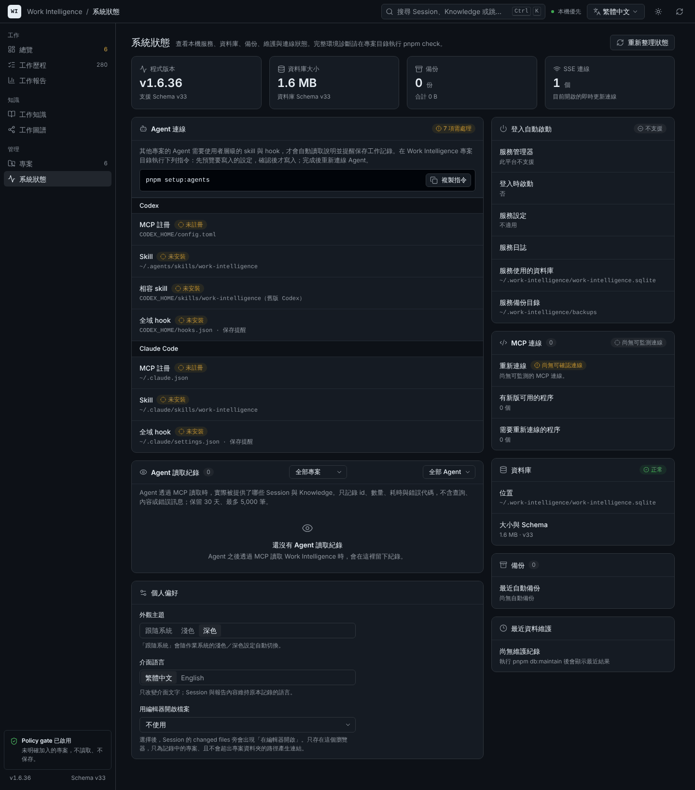

# Work Intelligence

[English](README.md) | **繁體中文**

**本機優先的開發工作記憶。** Codex、Claude 等 Agent 完成一段工作後，會把「做了什麼、改了哪些檔案、怎麼驗證」寫進你電腦上的一個 SQLite 檔案。你可以在 Web UI 回顧工作歷程，產生日、週、月、季、年或自訂期間的報告；之後 Agent 開工前或遇到錯誤時，也能從這裡找回過去的工作與 Knowledge。

- 🔒 **預設不記錄**：只有你明確設為「記錄中」的專案才會被讀取與保存，其他專案一律略過。
- 🏠 **資料只在本機**：API 只接受 `127.0.0.1` 的連線，不會把資料送到遠端，也不會在你的專案 repo 裡寫入設定檔。
- ✅ **未結項可核對**：Agent 收尾前取得與任務及檔案相關的項目，確認完成才結案；本次新項目取代舊工作時保留 Session 稽核，證據不足就維持未處理。Web 也支援每批最多 100 項的批次處理與復原；可發起整理請求，核對 Agent 附證據的建議後才接受。
- 🧾 **可追溯**：每筆摘要與報告結論都能回到來源 Session、檔案與證據。changed files 不等於 Git commit，也不會替 Agent 猜測驗證結果；修正與作廢都會留下紀錄。
- 💾 **帶得走、刪得掉**：每日自動備份、整份 SQLite 快照、單一或全部專案的 JSON 匯出與合併匯入，也可以永久刪除單一專案的資料並查看不含內容的刪除紀錄。
- 🩺 **能自己排除問題**：`pnpm check` 唯讀檢查整個環境；API 斷線時畫面上方會顯示提示，恢復後自動重新載入。

---

## 目錄

- [快速開始](#快速開始)
- [連接 Codex／Claude](#連接-codexclaude)
- [日常使用](#日常使用)
- [Web UI 導覽](#web-ui-導覽)
- [備份、換電腦與刪除](#備份換電腦與刪除)
- [升級與維護](#升級與維護)
- [核心概念](#核心概念)
- [安全與隱私](#安全與隱私)
- [專案結構與開發](#專案結構與開發)
- [文件索引](#文件索引)
- [授權](#授權)

## 快速開始

需求：**Node.js 22.16 以上的 22.x，或 24 以上**（建議 24；不支援 23.x，因為 22.13–22.15 與所有 23.x 內建的 SQLite 沒有搜尋索引需要的 FTS5），以及 **pnpm 11.16 以上**（見 `package.json` 的 `engines.pnpm`）。以下是約五分鐘的設定流程；第一次下載依賴可能需要較久。

```bash
git clone https://github.com/Ponpon55837/WorkLog.Ai && cd WorkLog.Ai
pnpm bootstrap
pnpm start
```

`pnpm bootstrap` 是唯一的安裝主線，會先檢查 Node.js 與 pnpm 版本並列出計畫，確認一次後依序執行：安裝依賴、建置、連接 Agent（`pnpm setup:agents`）、詢問是否設定登入自動啟動，最後用 `pnpm check` 診斷並印出下一步。前兩步只寫入這個 repo；**連接 Agent 與登入自動啟動這兩步會寫入你的全域設定，各自另外顯示預覽並要求確認**（Agent 設定要輸入 `yes`），不確認就不會變更。非互動終端只顯示計畫，加上 `--yes` 才會執行；`--skip-agents` 略過連接 Agent，`--service` 直接進入登入自動啟動設定。如果某個 Agent 已經啟用 Work Intelligence plugin，bootstrap 會自動略過該 Agent 的手動註冊（plugin 已提供 MCP、skill 與 hook），避免重複。若已安裝登入自動啟動服務，bootstrap 不會再詢問，只提醒你執行 `pnpm service:restart` 重啟服務。可重複執行，`git pull` 後再跑一次就是更新後同步。完整範圍、備份方式與解除安裝步驟見[Agent 設定指南](docs/agent-setup.md)。

`pnpm start` 啟動本機 Dashboard 與 REST API。終端機保持執行，按 `Ctrl+C` 停止。啟動時若偵測到 Agent 設定過期，會印出一行提醒（沒有問題時不輸出，也不會拖慢啟動）。正式模式由同一個 process、同一個 port 提供 Web UI 與 REST API。

如果希望在登入電腦後自動啟動，可先執行 `pnpm build`，再執行 `pnpm service:install`。安裝前會列出即將寫入的服務檔案與完整內容；確認後才會設定目前使用者的服務，無須管理員權限。`pnpm service:status` 查看狀態，`pnpm service:restart` 在更新後重啟（會等到 server 回報新版本才結束；Windows 上也會一併停止工作排程器留下的舊 server，重新安裝或移除服務時同樣如此），`pnpm service:uninstall` 停止並移除服務設定，保留資料庫、備份與日誌。各平台位置與排除問題方式見[登入自動啟動](docs/service.md)。

| 項目 | 位置 |
|---|---|
| Web UI | <http://127.0.0.1:3210> |
| REST API | <http://127.0.0.1:3210/api/health>（回傳程式版本與 schema 版本） |
| SQLite | `data/work-intelligence.sqlite`（可用 `WORK_INTELLIGENCE_DB` 指定） |

第一次使用前，建議先執行診斷：

```bash
pnpm check
```

請執行 `pnpm check`；舊的 `pnpm run doctor` 仍可使用。不要直接用 `pnpm doctor`：pnpm 11 把它保留給自己的命令，不會執行 Work Intelligence 的診斷。它會唯讀檢查 Node.js、pnpm、build 檔案、資料庫健康與 schema 版本、最近的備份與維護、API 是否可連線、MCP 註冊、skill 複本與全域保存提醒 hook，並用繁體中文列出修正建議。輸出不含任何工作記錄內容。

接著三步：

1. 開啟 <http://127.0.0.1:3210>，進入「專案」→「加入專案」，選擇要記錄的專案資料夾。
2. 將專案狀態切換成「記錄中」，並確認允許讀取的範圍。也可以改在終端機執行 `pnpm track <資料夾>` 一次完成第 1、2 步：它會先預覽專案名稱、路徑與狀態變化，輸入 `y` 確認後才加入並設為「記錄中」。只有你能這樣做，Agent 不能替你開始記錄。
3. 在 Codex 或 Claude Code 重新連線 Work Intelligence MCP（Codex 使用保存提醒 hook 時，請在 `/hooks` 檢查並信任它），之後照常工作；完成時請 Agent 保存這次工作。

如果還沒有記錄中專案或尚無 Session，總覽會顯示「加入專案 → 設為記錄中 → 連接 Agent → 第一筆工作記錄」四步清單，並連到相關頁面或提供安裝命令。

側欄底部會顯示目前的程式版本與 schema 版本。

## 連接 Codex／Claude

Work Intelligence 的 MCP 是**本機 stdio server**，由 Agent 自己啟動，不使用 Web 的 HTTP port。**`pnpm bootstrap` 已經透過 `pnpm setup:agents` 完成連接**，一般情況不需要再做以下步驟。以下是「其他安裝方式」，與 bootstrap **二選一**，不要同時使用；請用絕對路徑，讓 API、MCP 與 CLI 使用同一個資料庫。

### 其他安裝方式一：plugin（Claude Code／Codex，與 bootstrap 二選一）

Claude Code 與 Codex 都從這個 repo 的 marketplace 安裝 Work Intelligence；plugin 執行的是你本機的 checkout，所以先 build 一次並連結：

```bash
git clone https://github.com/Ponpon55837/WorkLog.Ai && cd WorkLog.Ai
pnpm install && pnpm build && pnpm plugin:link
```

**Claude Code**

```bash
claude plugin marketplace add Ponpon55837/WorkLog.Ai
claude plugin install work-intelligence@worklog-ai
```

重新開啟 Claude Code，`/mcp` 會顯示 `work-intelligence` 已連線。保存提醒不需要其他設定。

**Codex**

```bash
codex plugin marketplace add Ponpon55837/WorkLog.Ai
```

在 Codex 開啟 `/plugins` 安裝 `work-intelligence`，再開啟 `/hooks`，檢視這個 plugin 的 hooks 並選擇**信任（Trust）**；未信任的 hook 會被略過，MCP 與 skill 不受影響。重新開啟 Codex，`/mcp` 會顯示 `work-intelligence` 已連線。

| plugin 提供 | Claude Code | Codex |
|---|---|---|
| MCP server `work-intelligence`（回想、脈絡、保存、報告） | ✓ | ✓ |
| Skill `work-intelligence`（何時、如何使用工具） | ✓ | ✓ |
| Skill `dashboard`（開啟 Web UI） | ✓ `/work-intelligence:dashboard` | ✓ 直接請 Agent 開啟 |
| 保存提醒 hooks | ✓ | ✓（在 `/hooks` **信任**後） |

**開啟 Dashboard**：請 Agent「打開 Work Intelligence dashboard」（Claude Code 也可輸入 `/work-intelligence:dashboard`），或在 checkout 執行 `pnpm dashboard`。server 沒在執行時會在背景啟動，並開啟 <http://127.0.0.1:3210>。想要每次登入都自動啟動，執行一次 `pnpm service:install`。

**更新**：在 checkout 執行 `git pull && pnpm install && pnpm build`，再執行 `claude plugin update work-intelligence@worklog-ai`；Codex 執行 `codex plugin marketplace remove worklog-ai` 後重新加入。Agent 提示重新連線時照做即可。

**之前手動註冊過？** plugin 與下方的手動註冊擇一即可，兩者並存時 Agent 會看到兩份相同的工具與提醒。移除手動註冊：`claude mcp remove work-intelligence --scope user`／`codex mcp remove work-intelligence`，並刪除 Claude `settings.json` 與 Codex `hooks.json` 裡 Work Intelligence 的 hook；`pnpm check` 會指出重複的項目。

**沒有 checkout？** 每個 [GitHub Release](https://github.com/Ponpon55837/WorkLog.Ai/releases) 都附上 `work-intelligence-plugin-<版本>.zip`（內含 MCP server 的 plugin）與 `work-intelligence-<版本>.mcpb`（Claude Desktop 擴充），這兩個不含 Web UI；另外附上完整的獨立套件 `work-intelligence-<版本>.tgz`（API server、Web 介面、MCP server 與 `work-intelligence` 指令，見 [docs/standalone.md](docs/standalone.md)），以及列出每個附件 SHA-256 的 `SHA256SUMS.txt`。全部都需要 Node.js 22.16 以上（或 24 以上；不支援 23.x），資料存在 `~/.work-intelligence/data`。

遇到問題先執行 `pnpm check`，再看 [plugin 指南](docs/plugins.md) 的排錯表。

### 其他安裝方式二：手動註冊（與 bootstrap 二選一）

`pnpm setup:agents` 可單獨執行，預覽並安裝 Work Intelligence MCP 與 user-level skill；預設不會寫入。操作方式、備份與解除安裝見 [Agent 設定指南](docs/agent-setup.md)。MCP 也會用標準 `resources/list`／`resources/read` 提供 skill 與記錄格式，任何支援 MCP resources 的 client 都能讀取：每次工作都要讀的核心 `work-intelligence://agent/work-intelligence/SKILL.md`、開始報告、修正、整理未結項、Knowledge 或架構圖等流程時才讀的 `work-intelligence://agent/work-intelligence/references/<guide>.md`，以及 `work-intelligence://agent/work-record-and-report-format.md`。

macOS／Linux：

```bash
# Codex CLI
codex mcp add work-intelligence --env "WORK_INTELLIGENCE_DB=/path/to/WorkLog.Ai/data/work-intelligence.sqlite" -- pnpm --dir "/path/to/WorkLog.Ai" start:mcp

# Claude Code（user scope，所有 workspace 都能用）
claude mcp add --scope user --transport stdio work-intelligence --env "WORK_INTELLIGENCE_DB=/path/to/WorkLog.Ai/data/work-intelligence.sqlite" -- pnpm --dir "/path/to/WorkLog.Ai" start:mcp
```

Windows（PowerShell）：

```powershell
codex mcp add work-intelligence --env "WORK_INTELLIGENCE_DB=C:\path\to\WorkLog.Ai\data\work-intelligence.sqlite" -- pnpm.cmd --dir "C:\path\to\WorkLog.Ai" start:mcp

claude mcp add --scope user --transport stdio work-intelligence --env "WORK_INTELLIGENCE_DB=C:\path\to\WorkLog.Ai\data\work-intelligence.sqlite" -- pnpm.cmd --dir "C:\path\to\WorkLog.Ai" start:mcp
```

過期 MCP lease 與遺留暫存檔會在 MCP 註冊及系統狀態讀取時分批清理，預設門檻為 90 秒、每次最多 64 次刪除嘗試；詳見[疑難排解](docs/troubleshooting.md)。

Claude Code 另外提供兩個 MCP prompts：`/mcp__work-intelligence__finalize-work` 與 `/mcp__work-intelligence__synthesize-report`。Claude Desktop 的設定、驗證方式與常見問題見 **[docs/agent-setup.md](docs/agent-setup.md)**。更新 Work Intelligence 後，請重新 `pnpm build`。Agent 透過穩定的 MCP launcher（`apps/mcp/dist/launcher.js`，由 `pnpm setup:agents`、plugin 與 `pnpm start:mcp` 使用）連線：新建置出現時，它會等進行中的請求回覆、啟動新版 server 並重播握手，同一個連線就改用新版，不必重新連線；只有 launcher 本身更新時才需要重連一次。仍直接執行 `apps/mcp/dist/index.js` 的註冊維持舊規則（schema／Agent 契約改變時需重連），重新執行 `pnpm setup:agents` 即可改用 launcher。

### 保存提醒 hook（選用）

想讓 Agent 忘記保存時被提醒一次，可以加上保存提醒 hook。hook 和 MCP 一樣裝在**全域**，任何專案都能用；它只在「記錄中」的專案作用，其他專案一律放行，判斷失敗時也會放行。

| Agent | 全域設定檔 | 事件 | 腳本 |
|---|---|---|---|
| Claude Code | `~/.claude/settings.json` | `Stop`；選用 `PreToolUse`＋`PreCompact`＋`SessionStart`（`compact`） | `apps/mcp/dist/finalize-reminder.js` |
| Codex | `~/.codex/hooks.json` | `PostToolUse`（`apply_patch`、`work_finalize_session`）＋`Stop`；選用 `PreToolUse`＋`UserPromptSubmit`＋`SessionStart`（`compact`） | `apps/mcp/dist/codex-finalize-reminder.js` |

- 設定時請使用 repo 的絕對路徑，並先執行 `pnpm build`。
- Codex 需要在 `/hooks` 中檢查並信任這個 hook。
- 選用的壓縮 hook 讓長對話被壓縮後仍記得未保存的工作：Claude Code 的 `PreCompact` 請摘要保留這段工作的開始時間與改過的檔案（相對於專案的路徑，不含內容）；兩個 Agent 的 `SessionStart`（`compact`）會把未保存提醒與開始時間放回上下文。它們不會擋住壓縮。
- repo 不附專案層級的 `.codex/hooks.json`。
- 設定是否正確，可以用 `pnpm check` 檢查。

完整設定範例見 [保存提醒 hook](docs/agent-setup.md#保存提醒選用)。

## 日常使用

你只需要用自然語言跟 Agent 說話，工具名稱、request ID、JSON 都由 Agent 處理（規則寫在 [`.agents/skills/work-intelligence`](.agents/skills/work-intelligence/SKILL.md)）。

| 想做的事 | 在 Agent 對話中說 | 或在 Web UI |
|---|---|---|
| 確認有沒有在記錄 | 「這個專案有在 Work Intelligence 記錄嗎？」 | 專案 |
| 保存這次工作 | 「完成了，請把這次工作記錄到 Work Intelligence。」（非記錄中的專案會直接略過） | — |
| 整理既有未結項 | 「請整理這個專案的未結項。」 | 工作歷程 → 未結項：選擇專案並建立整理請求，查看來源、理由與證據後逐筆或批次接受／拒絕 |
| 接續前次未結項 | 「這次處理了哪些先前列出的未結項？」 | 工作歷程 →「未結項」可依專案與狀態篩選，標記完成、不再需要或重新開啟 |
| 取回專案脈絡 | 「先看一下 Work Intelligence 裡這個專案最近做了什麼。」 | 工作歷程、工作知識 |
| 查過去的工作或錯誤 | 「之前有處理過報告時區的問題嗎？」或直接貼上錯誤訊息（Agent 用 `work_recall` 排序檢索 Session、raw handoff 與 Knowledge；結構化工作欄位優先，重複的舊 handoff 計分會降低，固定軟體詞表可跨中英文找低信心線索。`work_search` 回傳帶 confidence 的精簡 Session 命中；`none` 代表沒有可引用依據，`high` 與 `low` 只代表字面相符，Agent 引用前會先讀完整記錄，來源無法直接支持答案時回答「資料不足」。帶任務的 `work_get_context` 還會從排名最前的 Session 補上最多 4 筆相關 Session 與曾套用的 active Knowledge 精簡指標，放在獨立的 `relevant.supplements`，不改變主要結果、排序與 confidence） | 工作歷程搜尋（多個關鍵字時每個都要命中） |
| 整理報告 | 「幫我整理這週的 Work Intelligence 報告。」（沒有請求時 Agent 會自己建立；自訂期間也可以） | 工作報告 →「請 Agent 整理這份報告」，Agent 完成後頁面會自動更新 |
| 整理 Knowledge 候選 | 「幫我整理 Work Intelligence 的 Knowledge 候選。」 | 工作知識 →「整理候選」，接受（可先修改）或拒絕後才會成為 Knowledge |
| 更新常駐知識頁 | 「幫我更新這個專案的知識頁。」 | 工作知識 →「知識頁」：架構與慣例、進行中的工作與未結項、常見陷阱，每段附來源 Session；來源需核對或新資料累積 3 筆時，Agent 會收到維護提示；頁面顯示最後檢查到的時間，可手動編輯與查看版本 |
| 補齊缺漏的 metadata | 「幫我補齊 Work Intelligence 的 metadata 缺口。」（沒有請求時 Agent 會自己建立） | 專案 → Metadata 回補 →「掃描 metadata 缺口」 |
| 修正已保存的摘要 | 「幫我修正上一筆 Session 的摘要：……」 | Session 面板 →「編輯 Session」 |
| 連結相關的工作 | 「這次是接續昨天那筆規劃的實作。」 | Session 面板 →「關聯 Session」 |
| 撤掉記錯的 Session | 「上一筆記到錯的專案，請作廢。」（可還原） | Session 面板 →「作廢」 |
| 匯入歷史 handoff | 「幫我預覽這個專案可以匯入的 handoff。」 | 專案 → Handoff 匯入 |

每筆 Session 都有一句話摘要，以及固定的五段內容：**成果／範圍／決策／驗證／狀態與未結項**。每個未結項都有穩定識別碼並連回來源 Session；既有資料升級時一律先標為未處理，不會推測它是否已完成。Agent 可在保存後續工作時回報已解決的項目，工作歷程的「未結項」分頁也能手動標記完成、不再需要或重新開啟。格式與報告粒度見 [Work record and report format v1](docs/work-record-and-report-format.md)。 補存歷史工作前先查既有 Session，實際起訖只使用對話或 hook 證據；資料不足時保留缺口，避免以 PR 合併時間推估。

### 量測自己的檢索品質

可以用私有題目重跑 recall 與 context，確認預期的 Session／Knowledge 是否出現在前段：

```bash
pnpm eval:recall ./recall-questions.json --db ./data/work-intelligence.sqlite --out ./recall-report.json
```

先執行 `pnpm build`（此 CLI 與 repo 其餘部分需要相同的 Node.js：22.16+ 或 24+）。每題指定 `mode: "recall"` 或 `"context"`、`query`、預期 id（可多筆）或 `expectedNoHit: true`；可選專案路徑與 recall 的起訖日期。報告列出各模式 hit@1、hit@5、MRR、每題排名、confidence、MCP 回應字元數與呼叫耗時。資料庫以 SQLite 唯讀連線建立 OS 暫存快照，檢索與索引同步只作用在快照；結果只到終端機或 `--out` 指定的新檔案，不會上傳，也不會覆寫任何已存在檔案。範例格式見 [`tests/fixtures/recall-eval-example.json`](tests/fixtures/recall-eval-example.json)，完整限制與指標定義見 [測試與驗證](docs/testing.md#檢索品質評估)。

更完整的操作說明見 **[使用手冊](docs/user-guide.md)**。

## Web UI 導覽

GitHub（Primer）風格的介面，有深色與淺色兩種主題，介面語言可選繁體中文或 English。左側選單分為「工作」「知識」「管理」三組，群組名稱隨介面語言切換。長清單都在各自的框內捲動，不會把整頁撐長。下列截圖使用虛構的示意資料，不含任何真實工作記錄。

**工作總覽**



**工作歷程**與 Session 詳情





**工作報告**



**工作知識**



**工作圖譜**（時間軸分頁）



**專案**



**系統狀態**



- **主題**：頁首的太陽／月亮按鈕切換淺色與深色。「系統狀態 → 個人偏好」可選「跟隨系統」，也是第一次開啟時的預設。淺色主題使用柔和的灰色底，而非純白。
- **語言**：頁首的語言選單切換繁體中文與 English。第一次開啟時依瀏覽器語言決定。只翻譯介面文字；Session、報告與 Agent 寫入的內容維持原本記錄的語言。
- 主題與語言都只存在這個瀏覽器，不會送到本機 API。
- 載入資料時，頁面會顯示「正在載入…」與佔位列；數量在確定前不會顯示。

| 頁面 | 用途 |
|---|---|
| **工作總覽** | 最上方是「工作熱度」日曆：近 53 週每天一格，依完成的 Session 數量深淺；點某一天開啟當日報告。接著是「本週的循環」（記錄 → 沉澱 → 修正），只放產品現在算得出來的數字：本週記錄的 Session 數、新增的 Knowledge、知識頁更新數，以及確認與推翻次數。下方是四張數字卡，「本週完成」附八週走勢；兩句洞察附對應報告入口，再往下是需要處理的工作、最近完成的工作與專案狀態。尚未有記錄中專案或 Session 時，顯示第一次使用的四步清單 |
| **工作歷程** | 多關鍵字搜尋所有 Session，並依專案、日期篩選。時間軸為每天一段小結（通過與驗證失敗的筆數），並顯示當天新增的 Knowledge 數。點任一 Session 會從右側開啟詳情，`J`／`K` 切換上下筆。「未結項」分頁可依專案、狀態與來源 Session 完成日期分頁查看，一次最多標記 100 項為完成或不再需要；每項都連回來源 Session。詳情會顯示寫入這筆 Session 的 Agent 用戶端。「複製為 Markdown」可貼到 PR 說明、站會訊息或交接；「Agent 讀取」列出 Agent 何時讀取過這筆 Session。「編輯 Session」可修正主摘要、五段內容與 verification（留有修改紀錄）；也可以建立關聯、作廢或還原 Session，並逐筆標示錯誤的 Evidence。Agent 新存的 Session 會自動出現 |
| **工作報告** | 日、週、月、季、年與自訂期間（最長 366 天）的報告，依頁首顯示的系統時區切日。總覽有每日分布直條、依專案堆疊的專案占比條，以及帶時段的條列。尚未有 AI 整理時，以一行橫幅與按鈕取代整張卡片。整理的每段都附來源 Session，可依版本釘選、隱藏或恢復，也可以手動改稿（保留原文，修改會留紀錄）。之後是趨勢、風險、跨期工作、原始紀錄與來源證據；可匯出 Markdown／JSON |
| **工作知識** | 四個分頁，各自顯示數量。**Knowledge**（Agent 明確提交的決策、模式、注意事項、流程與技能）的信任條只由確認與推翻次數畫成，並可看到對應的 Session。可能過時的原因顯示在標題下方：相關檔案被改動時標示「可能過時」，被 Session 推翻時標示「需要檢視」。「類型分布」顯示目前專案與狀態下各類型的數量；可以確認仍有效、編輯、封存與查看變更紀錄。**知識頁**是 Agent 依已記錄 Session 撰寫的常駐頁面，每段附來源；新 Session 會先標示「有新資料」，累積 3 筆或來源需要核對時，會提示 Agent 檢查，答案改變時才會重寫。**候選**是等你接受或拒絕的 Knowledge。**待確認決策**是 Agent 自主做的決策，可確認、否決或升級為 Knowledge |
| **工作圖譜** | 三個分頁。**時間軸**依專案分泳道，每天一根中性色長條，失敗的工作以紅色標示；拉近後 Session 畫成長條或點，關聯畫成弧線。Knowledge 的建立、確認、推翻與取代以標記呈現。日寬夠大時標示週末底色，專案名稱固定在左欄；手機寬度自動使用依日期分組的清單。**關係圖**顯示 Project、Session、Knowledge、Evidence、檔案與 Session 關聯；實線是記錄的關係，可開啟以虛線顯示的「一起修改」推導關係，並可在節點面板中逐段查看兩者如何關聯。**熱點**列出被最多 Session 修改的檔案或目錄，附驗證失敗與未執行的比例，以及最近 5 筆 Session。工作報告的「風險」也會列出本期被 2 筆以上 Session 修改的檔案 |
| **專案** | 專案清單與記錄狀態。加入時可用系統視窗選擇資料夾，也可設定 https 儲存庫網址，讓 Session 的 commit 連到該儲存庫。另有永久刪除專案、Metadata 回補、Handoff 匯入與資料備份（備份、匯出、匯入） |
| **Session 圖表** | Agent 在工作改到跨模組流程、資料流、狀態機或架構時，會為 Session 附上一到兩張原生 architecture 圖表。圖表卡片在 Session 面板中呈現；歷史 Mermaid 保留原始碼，可複製與下載。圖表可作廢、不能刪除，會隨專案匯出與匯入 |
| **系統狀態** | 程式與 schema 版本、資料庫位置與大小、最近的自動備份與備份總量、最近一次資料庫維護的結果、登入自動啟動服務，以及 Codex／Claude Code MCP 註冊、skill 複本與全域 hook 的唯讀狀態；此頁不會修改服務或 Agent 設定。「Agent 讀取紀錄」列出最近的 MCP 讀取（時間、Agent 與工具、專案、耗時、是否失敗，以及回傳的 Session id），並有各工具的次數與 p50／p95 耗時。「個人偏好」可設定外觀主題、介面語言，以及是否用 VS Code 或 Cursor 開啟變更的檔案（只存在這個瀏覽器）。完整環境診斷請執行 `pnpm check` |

總覽的提醒列可隱藏此次、七天後再提醒，或由隱藏／稍後清單重新顯示，待處理總數仍依原來源計算。報告可預覽並複製基本版 Markdown 或目前整理版；整理版重新核對來源與修訂版本後，保留釘選、隱藏、改稿及來源引用；剪貼簿存取失敗時可選取預覽文字或下載 Markdown。

Session 詳情提供最多五筆同專案共同檔案的相關工作提示，排除既有關聯，搜尋截短時明示；開啟提示不會建立關聯。

快捷鍵：`Ctrl`／`⌘` + `K` 搜尋、跳頁，或切換主題與介面語言；`/` 聚焦頁面搜尋；`g` + `d`／`s`／`r`／`k`／`g`／`p` 切換頁面。篩選條件與開啟中的 Session 都會寫進網址，可以直接分享或重新整理。

API 無法連線時，頁面上方會顯示「無法連線到 Work Intelligence API」，連線恢復後會自動重新載入目前的資料。

## 備份、換電腦與刪除

所有記錄都在一個 SQLite 檔案裡。

- **自動備份**：API server 每個本機日曆日自動備份一次，存到資料庫旁的 `backups/`。自動備份與手動備份分開保留，預設各保留最近 3 份，手動備份不會擠掉每日自動備份。備份檔只有目前的使用者可以讀寫。
- **手動備份**：Web UI 的「專案 → 資料備份 → 立即備份」，或執行 `pnpm db:backup`。備份、整庫匯出、專案資料匯出與匯入預覽都在 worker 執行，API 與畫面不會被卡住；啟動後的自動備份會延後 60 秒。
- **管理備份**：「專案 → 資料備份」會列出備份種類、時間、大小與總大小；刪除前會顯示檔名與種類並要求確認，刪除唯一一份列出的備份時會額外警告。CLI 可用 `pnpm db:backups` 列出，或在互動終端執行 `pnpm db:backups --delete <檔名>` 確認刪除。刪除專案後，刪除前備份與其他舊備份仍可能包含該專案資料，可從資料備份頁管理。
- **依專案攜帶資料**：在「專案 → 資料備份」可以匯出全部專案或單一專案的 JSON。CLI 用 `pnpm db:export --all` 或 `pnpm db:export --project <專案名稱或 id>`，加上 `--out <檔案.json>` 可以指定輸出位置。JSON 沒有加密，請妥善保管。
- **合併匯入**：
  - 在同一個分頁選擇 JSON 檔，預覽會顯示來源路徑與此電腦的資料夾狀態；找不到的專案可逐一選擇資料夾，或略過並以暫停狀態匯入。系統只檢查所選路徑是否為資料夾，不會讀取資料夾內容。
  - 若多個匯出路徑的父資料夾下有同名資料夾，UI 會列出候選路徑並要求你逐一確認後才採用。
  - CLI：`pnpm db:import <檔案.json> --dry-run` 只預覽；互動匯入時會為找不到的資料夾逐一詢問新位置，直接按 Enter 可略過。也可使用 `--remap-root <舊路徑>=<新路徑>`，最後輸入 `yes` 才寫入。
  - 可以重複執行；新匯入的專案會先暫停。相同專案 ID 已存在時會沿用本機根路徑，Mac 與 Windows 互相匯入不必加 `--remap-root`。
  - 兩台電腦都持續記錄同一個專案時，選「較新者優先」（Web 預設，CLI 用 `--strategy newer-wins`）：兩邊都改過的資料取較新的版本、本機較新的保留、歷史紀錄只新增，兩邊的知識頁版本都保留並依時間重新編號。預覽會列出將更新幾筆、保留本機幾筆，其餘衝突依原因彙總。「只新增」（`merge`，CLI 預設）不會覆寫既有資料。
  - 匯入透過正在運作的 API／SQLite 合併，不必先停服務。
- **路徑轉換**：`--remap-root` 可以重複使用，以完整的路徑片段比對。Windows 路徑不分大小寫，並依新路徑轉換分隔符號。它只調整匯入資料裡的專案根路徑與 handoff 來源路徑，不會用匯入的路徑讀寫檔案。
- **專案重新指定位置**：專案頁會以資料夾狀態提示找不到或無法確認的路徑；「重新指定位置」只選擇並驗證新資料夾，接著更新專案根路徑與該專案原始快照的路徑前綴。若專案正在記錄，操作前會要求確認 Agent 可讀寫的新範圍。稽核只保存時間、專案 id 與是否更新路徑，不保存路徑；MCP 沒有改路徑或刪除能力。
- **換電腦**：
  1. 在舊電腦按「匯出整份資料」（或執行 `pnpm db:export <檔案>`），得到一個 `.sqlite` 檔。檔案包含全部工作記錄且沒有加密，請用可信任的方式帶到新電腦。
  2. 在新電腦執行 `pnpm build`，停止 API server，並關閉會啟動 MCP 的 Agent 對話。
  3. 執行還原：

     ```bash
     pnpm db:restore <匯出的檔案> --remap-root <舊電腦的專案上層路徑>=<新電腦的路徑>
     ```

  專案在新電腦的位置相同時，不用加 `--remap-root`；也可以加多組。還原前會檢查檔案完整性與版本、自動備份新電腦上原本的資料；只要資料庫仍被 server 或 Agent 開著就一律停止（沒有強制旗標）。用備份還原也是同一個指令。

- **永久刪除專案**：在「專案 → 專案清單」按專案旁的垃圾桶，閱讀刪除範圍後輸入完整的專案名稱才能確認。
  - 會先建立並驗證一份完整備份，備份失敗就不刪除。
  - 在單一交易內刪除該專案的 Session、事件、handoff、Evidence、Knowledge、候選、報告整理、修改紀錄、搜尋索引，以及其他專案指向它的關聯。
  - 只留下一筆不含內容的刪除紀錄（時間、專案 id、各類筆數）。
  - 「專案 → 刪除紀錄」可查看每筆刪除的時間、專案 id 與各類筆數，不含專案名稱、路徑或已刪除內容。
  - 專案資料夾本身不會被動到。MCP 沒有刪除工具，只有你能在 UI 或 REST API 刪除。
  - **刪除後，資料仍存在於刪除前的各種備份與匯出檔中**，直到它們被輪替掉或你自行刪除。細節見[使用手冊](docs/user-guide.md#永久刪除專案資料)。

備份相關的環境變數：

| 環境變數 | 用途 |
|---|---|
| `WORK_INTELLIGENCE_BACKUP_DIR` | 備份目錄，預設是資料庫旁的 `backups/`。相對路徑以資料庫所在資料夾為基準，API、MCP、CLI 與 doctor 都會指向同一個位置 |
| `WORK_INTELLIGENCE_BACKUP_KEEP` | 手動備份保留份數，預設 3；自動備份另外保留 3 份 |
| `WORK_INTELLIGENCE_BACKUP=off` | 關閉每日自動備份 |

## 升級與維護

**升級**：`git pull`，再執行 `pnpm bootstrap`（會重新安裝、建置並同步 Agent 設定、最後跑診斷），依提示重新連線 Agent。若用 `pnpm start` 執行，請重新啟動它；若已安裝登入自動啟動服務，請執行 `pnpm service:restart` 重啟服務，它會等到 server 回報新版本才結束。

- 新版本需要升級資料庫時，第一次開啟前會自動建立一份 migration 前備份（`pre-migration-v<版本>-…`），再在單一交易內套用 migration；備份失敗時不會升級。
- 如果資料庫的 schema 比目前的程式新（例如在另一台電腦用過新版本），API、MCP 與 CLI 都會拒絕開啟，並提示你先更新 Work Intelligence，不會崩潰或只做一部分。
- 詳細步驟見[使用手冊](docs/user-guide.md#更新-work-intelligence)，版本變更見 [CHANGELOG](CHANGELOG.md)。

**資料庫維護**：

```bash
pnpm db:maintain
```

它會先建立維護前備份，再執行 `integrity_check`、`VACUUM`、`ANALYZE` 與搜尋索引重建，結果會記錄下來供 `pnpm check` 顯示。它需要獨占資料庫，所以執行前請先停止 `pnpm start`，並關閉會啟動 MCP 的 Agent 對話；資料庫仍被開著時，它會停止並提示你，同時列出 server 是否在執行與有幾個 Agent MCP 連線在使用（唯讀偵測）。

`pnpm check`（`pnpm bootstrap` 最後也會執行）在資料庫檔內未使用空間至少 1 MiB，且達 5 MiB 或檔案的 20% 時，會提示可執行 `pnpm db:maintain`；它只提示，不會自動執行。

遇到問題時，先執行 `pnpm check`，再看 **[疑難排解](docs/troubleshooting.md)**。

## 核心概念

**專案記錄狀態（default deny）**

| 狀態 | 意義 |
|---|---|
| 未註冊 `unregistered` | 剛加入時的預設值，不讀取、不保存 |
| 記錄中 `tracked` | 你明確授權；Agent 可以讀取 handoff／Git／source 並保存工作紀錄 |
| 已暫停 `paused` | 暫停記錄，既有資料保留 |
| 已忽略 `ignored` | 明確排除 |

不是「記錄中」的專案，所有 Agent 請求都會回傳 `skipped`，也不會讀取任何檔案。Agent 不能替你把專案切換成「記錄中」。

**幾個容易混淆的區分**

- **Finalize ≠ Git commit**：一次工作可以沒有 commit；changed files 只代表檔案曾經變動。
- **Verification 分開呈現五種狀態**：通過、失敗、進行中（`in_progress`）、明確未執行（`not_run`）、未回報（歷史資料沒有提供）。驗證已開始但結果尚未確定時，可在「編輯 Session」選擇「進行中」；確認結果後原地改為通過或失敗。開始工作不等於通過，報表與可攜式匯出會保留這項區別；記錄定稿與驗證狀態各自獨立。
- **報表數字 ≠ AI 摘要**：統計與趨勢由系統固定規則計算；AI 整理的每段結論都必須引用來源 Session，資料不足時會直接寫「資料不足」。
- **Knowledge 只收明確提交的內容**：不會從 handoff 或原始碼自動抽取。候選由 Agent 提出，由你接受後才成為 Knowledge。
- **修正留痕跡，不重寫歷史**：主摘要、五段 workSummary 與 verification 可以由 Agent 或 Session 面板就地修正（同一筆 Session，留下修改紀錄）。記錯的 Session 與錯誤的 Evidence 用作廢處理（需要填原因，可以還原）。changed files、events 與 Evidence 內容維持唯讀。
- **開工前的改動不算這次的成果**：Agent 可以在開工時記下已存在的改動（`baselineChangedFiles`），finalize 時會從 changed files 排除。
- **Knowledge 會提醒自己過時**：`appliesTo` 列出的檔案之後被改動時，會標示「可能過時」。
- **作廢 ≠ 刪除**：作廢可以還原；永久刪除只針對整個專案，而且需要你親自確認。

更完整的資料契約、一致性保證與設計原則見 [docs/architecture.md](docs/architecture.md)。

## 安全與隱私

- API 只監聽 `127.0.0.1`，並檢查 `Host` 與 `Origin`。正式模式下 Web 與 API 同源，另外加上 Content-Security-Policy、`X-Frame-Options: DENY`、`X-Content-Type-Options: nosniff` 與 `Referrer-Policy: no-referrer`。
- 靜態檔案會阻擋 `..`、編碼過的路徑與指向外部的 symlink。
- 錯誤回應只包含固定的訊息，不會外洩 SQLite 或檔案系統的內部細節。
- 文字保存前會遮蔽已知格式的憑證，並把 `<private>…</private>` 包住的內容換成 `[REDACTED:private_block]`（區塊必須有結尾標籤，沒有結尾的標籤會照原文保存）；`pnpm db:redact` 以相同規則整理既有資料，詳見 [SECURITY.md](SECURITY.md#敏感資料遮蔽)。
- 備份與匯出檔沒有加密，請用可信任的方式保存與傳輸。
- 使用 MCP 時，Agent host 可能依其設定把工具結果送到遠端模型，這部分由 Agent host 的政策決定。
- 成功的 MCP 讀取會在本機留下稽核紀錄，只存 id 與數量（不存查詢或內容），保留 30 天或最新 5,000 筆，刪除專案時一併移除。

威脅模型與漏洞回報方式見 [SECURITY.md](SECURITY.md)。

## 專案結構與開發

```text
apps/
  web/       Vue 3 + Vite Web UI（GitHub/Primer design system，深色／淺色主題，繁體中文／English 介面，文字放在各語系的 JSON 目錄）；Pinia store 管理狀態，Pinia Colada 管理 API 資料的快取與失效
  server/    REST API、正式模式靜態檔、CLI（db:*）、doctor 與獨立套件的 `work-intelligence` 指令
  mcp/       MCP stdio server、Agent 連線用的穩定 launcher 與保存提醒 hook
packages/
  core/            domain types 與 extension interfaces
  schema/          Zod 輸入契約
  storage/         SQLite schema、migration，以及報告、synthesis、backfill、recall、備份、資料轉移、刪除與維護等 service
  project-policy/  default-deny policy gate 與安全路徑
  shared/          共用常數、版本與 helpers
tests/             各 package 的單元／整合測試與 Playwright E2E（依 package 分資料夾）
scripts/           正式模式啟動、plugin 與獨立套件的打包及其 smoke test、build 前清除 dist
data/              本機 SQLite 與 backups/（不進版控）
```

```bash
pnpm dev                      # 開發模式：Web UI 5966（Vite）＋ API 3210
pnpm start                    # 正式模式：Web 與 API 同一個 port（需先 build）
pnpm dashboard                # 必要時啟動正式模式 server，並開啟 Web UI
pnpm plugin:link              # 讓 Claude Code／Codex plugin 找到這個 checkout
pnpm build:plugin             # 在 dist/plugin/ 產生自帶 MCP 的 plugin zip 與 Claude Desktop .mcpb
pnpm build:standalone         # 在 dist/standalone/ 產生不需 checkout 的套件與 tarball（docs/standalone.md）
pnpm start:server             # 只啟動 API
pnpm start:mcp                # 只啟動 MCP stdio server
pnpm check                    # 唯讀診斷
pnpm track <資料夾>            # 預覽並確認後，加入資料夾並設為記錄中
pnpm db:backup                # 立即備份（db:export、db:import、db:restore 見上方）
pnpm db:backups               # 列出備份；加 --delete <檔名> 可互動確認刪除
pnpm db:maintain              # 離線維護（需先停止 server 與 MCP）
pnpm test                     # ESLint、程式碼擺放順序、Prettier 檢查，以及各 package 與 Web 單元測試
pnpm test:coverage            # 覆蓋率（schema、storage、server、mcp、web 各有門檻）
pnpm test:performance         # 合成資料的讀取路徑效能門檻（需先 build）
pnpm test:retrieval-quality   # 合成資料的 work_recall 檢索品質門檻（hit@5、MRR）
pnpm eval:recall <題目.json>  # 在本機唯讀評估 recall/context（可加 --db 與 --out）
pnpm test:response-size       # 合成 MCP 輸出大小基線與 CI 上限
pnpm typecheck                # packages、Vue 與 E2E 型別
pnpm test:e2e                 # build 後以正式模式跑 Playwright（Chromium 全套、Firefox／WebKit 核心流程），使用獨立的暫存 SQLite
pnpm format                   # 用 Prettier 格式化整個 repo
```

CI 在 Ubuntu、Windows、macOS 跑 build、test、typecheck、coverage 與獨立套件 smoke test（`pnpm test:standalone`），另以 Node 26 跑 storage 測試；Ubuntu 另外跑生產依賴安全稽核（high／critical 即失敗）、效能、檢索品質與 MCP 回應大小門檻，以及 Chromium／Firefox／WebKit E2E（Chromium 與 Firefox 掃描六個主要頁面、系統狀態、備份管理與第一次使用清單的 axe 無障礙檢查）。Ubuntu WebKit 不代表 macOS Safari 實機驗證。細節見 [docs/testing.md](docs/testing.md)。

其他設定：

- `WORK_INTELLIGENCE_DB`：SQLite 位置。
- `WORK_INTELLIGENCE_PORT`：正式模式的 port，預設 `3210`。
- `WORK_INTELLIGENCE_ALLOWED_ORIGINS`：正式模式同源，不需要額外設定。開發模式或自訂來源使用非預設的 Web origin 時，在 `.env` 設定這個變數（逗號分隔，不能用 `*`），其中的主機也會加入 API 的 `Host` 白名單。
- 報告與日期篩選依 server 所在的系統時區切日（Node 會遵守 `TZ` 環境變數）。

開工前請先讀對應的共用 skill（Codex 與 Claude 共用，放在 `.agents/skills/`）：

| 範圍 | skill |
|---|---|
| Web UI 的設計與資料語意 | [`worklog-ui`](.agents/skills/worklog-ui/SKILL.md) |
| Web 程式碼規範（Vue、TypeScript、Pinia store、query key） | [`worklog-web-code-style`](.agents/skills/worklog-web-code-style/SKILL.md) |
| storage、server、MCP（migration、錯誤代碼、效能規則、新資料表的匯出與刪除） | [`worklog-backend`](.agents/skills/worklog-backend/SKILL.md) |
| 所有檔案的程式碼擺放順序（先宣告後使用、生命週期位置等，`pnpm lint` 會檢查） | [`worklog-code-layout`](.agents/skills/worklog-code-layout/SKILL.md) |
| Agent 如何使用 Work Intelligence 的 MCP 工具 | [`work-intelligence`](.agents/skills/work-intelligence/SKILL.md) |

開發流程、健康檢查與 PR 規則見 [CONTRIBUTING.md](CONTRIBUTING.md)。

## 文件索引

| 文件 | 內容 |
|---|---|
| [docs/user-guide.md](docs/user-guide.md) | 安裝、正式模式、日常使用、報告、Knowledge、備份、刪除、換電腦與升級 |
| [docs/release.md](docs/release.md) | SemVer、發行前檢查、tag-only GitHub Release 與跨版本升級 |
| [docs/release-checklist.md](docs/release-checklist.md) | 各平台實機驗收步驟與使用者結果欄位；未執行的項目保持待驗收 |
| [docs/troubleshooting.md](docs/troubleshooting.md) | API 連線、port、MCP、全域 hook、還原、匯入與維護的常見問題 |
| [docs/service.md](docs/service.md) | macOS、Windows 與 Linux 的使用者層級登入自動啟動、移除與疑難排解 |
| [docs/agent-setup.md](docs/agent-setup.md) | 註冊到 Codex CLI、Claude Code、Claude Desktop，以及全域保存提醒 hook |
| [docs/plugins.md](docs/plugins.md) | Claude Code／Codex plugin：安裝、`pnpm plugin:link` 與從手動註冊切換 |
| [docs/standalone.md](docs/standalone.md) | 不需要 checkout 的獨立套件：版面、`work-intelligence` 指令、資料位置、`check` 檢查項目與 smoke test |
| [docs/mcp-tools.md](docs/mcp-tools.md) | 每個 MCP tool 的用途、欄位、範例、policy 行為、annotations 與 prompts |
| [docs/rest-api.md](docs/rest-api.md) | REST endpoints、小寫 snake_case 錯誤碼、metadata backfill、報告匯出、備份、專案資料匯出／匯入、刪除與即時更新串流 |
| [docs/work-record-and-report-format.md](docs/work-record-and-report-format.md) | Session 五段格式、報告粒度與回填邊界 |
| [docs/architecture.md](docs/architecture.md) | 資料契約、一致性與輸入邊界、Recording Policy、設計原則 |
| [docs/testing.md](docs/testing.md) | 測試指令、覆蓋率、效能、檢索品質與無障礙門檻，以及 E2E 範圍 |
| [docs/status.md](docs/status.md) | 專案現況、未結項與暫緩項目 |
| [CHANGELOG.md](CHANGELOG.md)、[docs/releases/](docs/releases/) | 版本變更紀錄與各版繁體中文更新指南 |
| [CONTRIBUTING.md](CONTRIBUTING.md) | 開發流程、健康檢查、PR 與工作記錄規則 |
| [SECURITY.md](SECURITY.md) | 威脅模型、本機安全邊界與私密漏洞回報方式 |

## 授權

[MIT](LICENSE)
