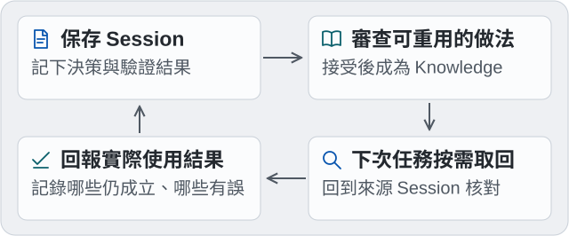
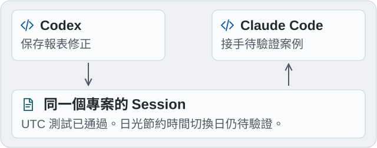
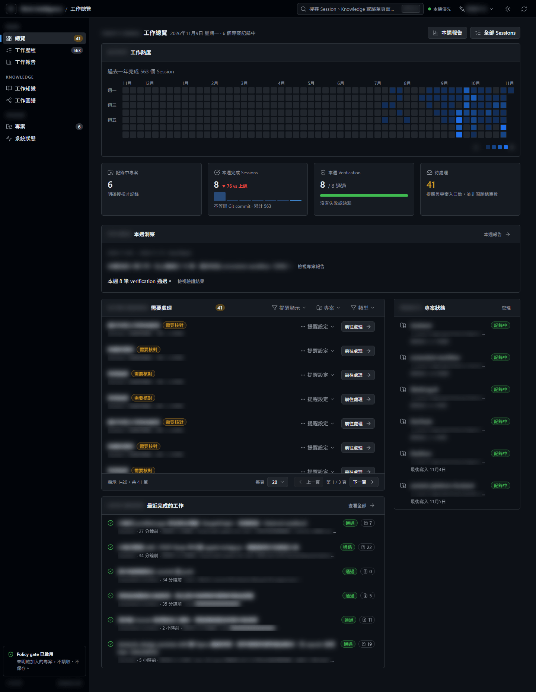
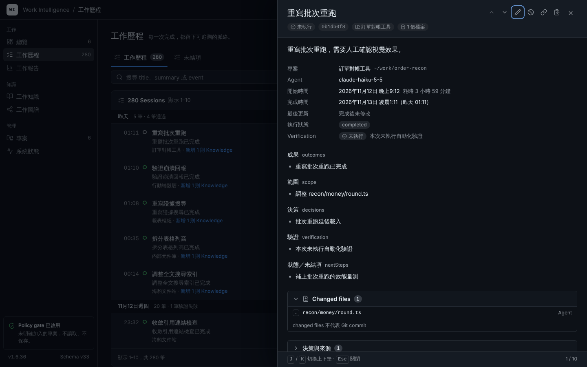
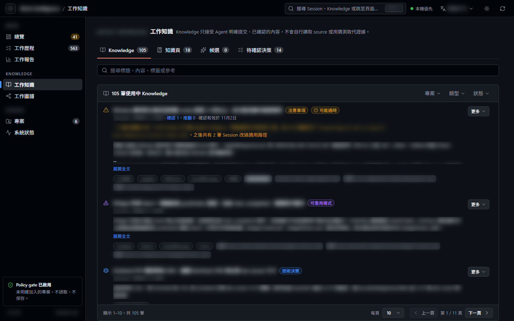
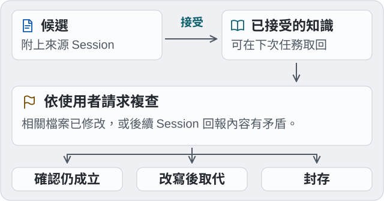
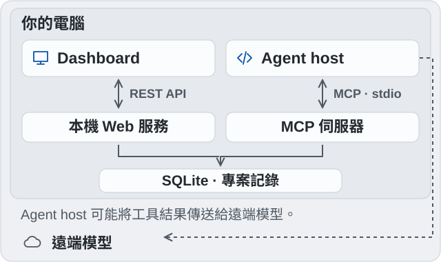

# WorkLog.Ai

[English](README.md) | **繁體中文**

**讓 AI 編碼 Agent 擁有經過驗證的經驗，而不只是記憶。**

Developer Work Intelligence，適用於 Codex 和 Claude Code。WorkLog.Ai 在本機保存專案改了什麼、為什麼這樣改，以及哪些檢查通過或失敗。下次再改同一個檔案，或換另一個 Agent 接手時，你可以直接問當時的決定和依據。

## 下載與安裝

Work Intelligence 桌面 App 支援 **Windows 11（x64）** 與 **macOS（Apple Silicon 或 Intel）**。Windows 請選 x64 安裝檔，Apple Silicon Mac 請選 arm64 磁碟映像檔，Intel Mac 請選 x64 磁碟映像檔。[到 GitHub Releases 下載](https://github.com/Ponpon55837/WorkLog.Ai/releases/latest)

安裝檔沒有發行者簽章，Windows SmartScreen 或 macOS Gatekeeper 可能會顯示提示。可用同一個發行頁面的 `SHA256SUMS.txt` 核對檔案。[安裝提示與檔案驗證步驟](docs/user-guide.md#桌面-app-檢查更新)

## 如何運作

修改檔案前，可以請 Agent 查它過去改過什麼。每筆 Session 會記下這次工作的成果、範圍、決策、驗證結果與未結項。下次任務碰到同一個檔案時，Agent 可以回到來源 Session，查清楚哪些情況已經測過、哪些還需要確認。

<picture>
  <source media="(prefers-color-scheme: dark)" srcset="docs/images/zh-TW/experience-loop-dark.svg">
  
</picture>

## 三步驟保存第一筆 Session

1. **選擇要記錄的專案。** 開啟 App，按「使用預設設定開始」。若找到既有資料庫，也可以選「沿用這份資料」。從工作列選單「開啟 Dashboard」，到「專案 → 加入專案」選擇資料夾，將狀態設為「記錄中」。只有你能開啟專案記錄。
2. **連接 Agent。** 在桌面 App 的「Agent」分頁選 Codex 或 Claude Code，按「預覽變更」，核對要修改的檔案後按「套用變更」，再按「測試連線」。在記錄中的專案開一個新的 Agent 對話。
3. **保存並確認結果。** 完成一項工作後，告訴 Agent：「請把這次工作存到 WorkLog.Ai，記下測過什麼、還有哪些事沒做。」到 Dashboard 的「工作歷程」點開新存的 Session，就能核對內容。

## 實際使用情境

| 使用時機 | 可以這樣問 Agent |
| --- | --- |
| 改檔案前想了解原先的決定 | 「之前為什麼在報表格式化時轉換時間戳記？請找出當時做決定的 Session。」 |
| 又遇到相同的測試失敗 | 「以前碰過這個時區測試失敗嗎？當時試過哪個修法，結果怎麼樣？」 |
| 整理本週工作報告 | 「這週完成了哪些工作？請整理成報告並附上來源 Session。」 |
| 換另一個 Agent 接手 | 「找出 Codex 保存的報表修正紀錄，還有哪個情況沒測？」 |

例如，Codex 修正報表後，記下 UTC 測試已通過，日光節約時間的案例還沒測。你可以在同一個記錄中的專案開啟 Claude Code，請它透過 MCP 讀取這筆 Session，接著驗證剩下的案例並保存結果。

<picture>
  <source media="(prefers-color-scheme: dark)" srcset="docs/images/zh-TW/agent-handoff-dark.svg">
  
</picture>

## 產品預覽

**工作總覽**列出近期工作，以及需要留意的項目。

在 **Session 詳情**可以對照一次修改的成果、驗證結果與證據。

在**工作知識**審查候選，也可以查閱專案已接受的 Knowledge。

## 專案知識如何審查與更新

一筆 Session 記下單次改動。若這次的做法也適用於其他工作，Agent 可以提出 Knowledge 候選，並附上來源 Session。你可以先核對證據、修改文字，再決定接受或拒絕，也可以明確請 Agent 審查待確認項目。

後續工作可能證實或推翻已接受的 Knowledge。相關檔案有變動時，可以重新核對原本的做法是否仍然適用，再決定保留、改寫或封存，並查看變更紀錄。[工作知識操作說明](docs/user-guide.md#工作知識)

<picture>
  <source media="(prefers-color-scheme: dark)" srcset="docs/images/zh-TW/knowledge-lifecycle-dark.svg">
  
</picture>

## 本機架構與隱私

只有你明確設為「記錄中」的專案才會被讀取與保存。Dashboard 連到只監聽 `127.0.0.1` 的本機服務。Codex 和 Claude Code 透過本機 MCP 伺服器查詢同一份 SQLite 資料庫。

<picture>
  <source media="(prefers-color-scheme: dark)" srcset="docs/images/zh-TW/local-privacy-dark.svg">
  
</picture>

Agent host 可能依自身政策將工具結果傳給遠端模型。備份與匯出檔案**沒有加密**，請留意保存位置與分享對象。[安全設計與漏洞通報](SECURITY.md) · [備份與還原](docs/user-guide.md#換電腦與還原)

## 文件與開發

**給從原始碼啟動的開發者。** 在專案目錄執行 `pnpm bootstrap`，完成後以 `pnpm start` 啟動本機 Dashboard。環境需求與測試指令見下方的開發文件。

| 主題 | 文件 |
| --- | --- |
| 桌面 App | [使用手冊](docs/user-guide.md) · [設定 Agent](docs/agent-setup.md) · [疑難排解](docs/troubleshooting.md) |
| Dashboard 頁面 | [用量](docs/user-guide.md#用量) · [工作報告](docs/user-guide.md#報告與-knowledge) · [工作圖譜](docs/user-guide.md#工作圖譜) |
| 開發與命令列 | [開發環境與測試](CONTRIBUTING.md) · [獨立套件](docs/standalone.md) · [登入自動啟動](docs/service.md) |
| 工具與整合 | [架構與資料契約](docs/architecture.md) · [MCP 工具](docs/mcp-tools.md) · [REST API](docs/rest-api.md) |
| 發行紀錄 | [版本紀錄](CHANGELOG.md) · [各版說明](docs/releases/) · [發行流程](docs/release.md) · [專案現況](docs/status.md) |

## 授權

[MIT](LICENSE)
